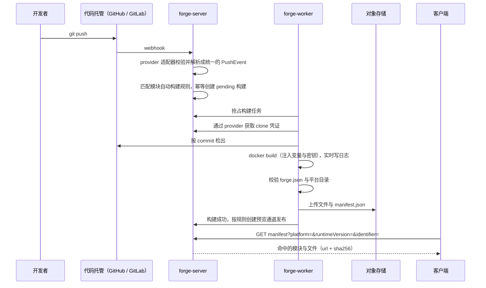

# RN 测试环境接入 P0 方案

## 背景与原则

Forge 的目标是一个通用的 RN Bundle 构建与交付平台：平台提供通用能力，再通过适配器兼容具体公司的基建。第一个落地场景是公司客户端的 **RN 测试环境**：测试包客户端可以切到 Forge 拉包，线上包继续走晴空塔。

**判断标准：换一家公司来用，只需要改配置和接入文档，不需要改代码。** 达不到这个标准的能力就是定制，不能放进平台。

本方案分为三层：

| 层 | 内容 | 与具体公司的关系 |
| --- | --- | --- |
| 核心 | 应用、模块、环境、构建、发布路由、`forge.json` 构建契约、`runtimeVersion` 匹配、拉包协议 | 无关 |
| 适配器 | 代码源（GitHub、GitLab）、对象存储（S3 兼容）、身份源（飞书）、密钥加密 | 按接口实现，通过配置启用 |
| 接入约定 | [小米 RN 接入指南](xiaomi-rn-integration.md)：`runtimeVersion` 拼接规则、Dockerfile 模板、产物格式、GitLab 配置步骤 | 只写在文档里，不进入平台代码 |

构建方式采用 **平台构建**，与 Vercel、Netlify、EAS Build 一致：平台连接代码仓库，由平台的 worker 拉取代码、执行仓库自己的 Dockerfile、上传产物。

## P0 范围

1. **代码源抽象**：统一的连接模型和 provider 接口。现有 GitHub 实现迁移到这套模型上，新增 GitLab 适配器（支持任意 GitLab 实例）。
2. **构建能力**：自动触发、按 commit 检出、构建变量与密钥、构建日志。
3. **构建契约与发布路由**：`forge.json` + 平台目录，路由按 `runtimeVersion` 隔离，拉包按平台过滤。
4. **通用化清理**：去掉现有代码里与具体公司绑定的写法，详见第 5 节。

不在 P0：身份源抽象（OIDC）、Git OAuth 授权、自动注册 webhook、构建取消与重试、CI 推送产物接口、晴空塔协议兼容、复杂灰度策略、审批与审计、sourcemap。这些都列在第 8 节。

## 总体流程



## 1. 核心：构建契约

### 1.1 产物结构

模块的 Dockerfile 最终导出的 `/app/dist`（沿用现有约定）必须满足以下结构：

```text
dist/
  forge.json         # {"runtimeVersion": "<string>"}
  <platform>/...     # 每个平台一个目录，至少一个
```

- **平台**：一级目录名就是平台名，取值为 `android`、`ios`、`harmony`。这份列表定义在 domain 层，新增平台只需要改常量，不涉及表结构。一次构建可以包含多个平台，发布时一起生效，相当于 EAS 的 update group。
- **runtimeVersion**：一个不透明字符串，长度 1-64，字符集 `[A-Za-z0-9._-]`。平台不解释它的含义，只在拉包时做精确匹配。它的作用是保证"包与客户端原生版本兼容"，具体怎么生成由接入方自己约定（参见各接入指南）。
- worker 在上传之前做校验：如果 `forge.json` 缺失或不合法，或者平台目录不符合约定，构建直接失败，失败原因写入日志。
- `forge.json` 只放平台需要的字段，以后需要扩展时（例如声明产物入口文件）再加，不允许接入方塞自定义字段。

### 1.2 产物格式

平台不解析 bundle 的内容，只负责存储、生成清单和路由。清单中每个文件包含 `path`、`size`、`contentType`、`sha256`。如果客户端需要额外的摘要算法，可以在清单里新增一个通用的 `digests` 字段，例如 `{"sha256": "...", "md5": "..."}`，由平台的配置项决定计算哪些算法，不针对某一个客户端单独加字段。

产物的具体形态（单个压缩包还是散文件、内部目录结构）由各接入方的 Dockerfile 和客户端自行约定。

## 2. 核心：构建执行与触发

### 2.1 模块构建配置

```sql
-- modules
dockerfile_path text not null default 'Dockerfile',
build_context text not null default '.',
auto_build_branches text[] not null default '{}',       -- glob，空数组表示不自动构建
auto_build_environment_code text references environments(code) on delete set null,
auto_preview_release boolean not null default false,     -- 自动构建成功后，用分支名创建定向发布
auto_preview_ttl_hours integer not null default 168
```

- 允许同一个仓库按不同的 Dockerfile 绑定成多个模块，用来支持 monorepo，相当于 Vercel 的 Root Directory。唯一约束见 3.2。
- 现有的全局配置 `FORGE_WORKER_DOCKERFILE` 只作为新建模块时 `dockerfile_path` 的默认值。

### 2.2 构建变量与密钥

```sql
create table module_build_variables (
    module_id text not null references modules(id) on delete cascade,
    key text not null check (key ~ '^[A-Z][A-Z0-9_]{0,63}$'),
    value_encrypted text not null,
    is_secret boolean not null default false,
    environment_code text references environments(code) on delete cascade, -- 为空表示适用于所有环境
    updated_by_user_id text not null references users(id) on delete restrict,
    updated_at timestamptz not null default now(),
    unique nulls not distinct (module_id, key, environment_code)
);
```

- 普通变量通过 `--build-arg` 传入。密钥变量通过 BuildKit 的 `--secret` 传入，不会写进镜像层。worker 需要使用 BuildKit。
- 用户变量的 key 不能以 `FORGE_` 开头，这个前缀留给平台注入的变量，保存时会被拒绝。
- 密钥变量传给 docker CLI 时，环境变量名是 `FORGE_BUILD_SECRET_<KEY>`，参数为 `--secret id=<KEY>,env=FORGE_BUILD_SECRET_<KEY>`。密钥值只出现在 docker 进程的环境变量里，不出现在命令行参数中。Dockerfile 里仍然按 `id=<KEY>` 挂载，例如 `RUN --mount=type=secret,id=NPM_TOKEN,env=NPM_TOKEN npm ci`（`env=` 写法要求 Dockerfile 语法 ≥ 1.10）。
- 同一个 key 同时有通用值和环境专属值时，以环境专属值为准。接口不会返回密钥变量的原值。
- 平台固定注入以下变量：`FORGE_ENVIRONMENT`、`FORGE_BRANCH`、`FORGE_COMMIT_SHA`、`FORGE_BUILD_ID`、`FORGE_MODULE_ID`。
- `unique nulls not distinct` 要求 PostgreSQL 15 及以上，部署文档需要写明这个最低版本。

### 2.3 触发与检出

- **手动构建**：在控制台选择分支。检出后执行 `git rev-parse HEAD`，结果写入 `commit_sha`。
- **push 触发**：provider 适配器把各家的 webhook 统一解析成 `PushEvent{connectionId, externalRepositoryId, branch, commitSha}`，之后的流程与 provider 无关：
  1. 找出绑定该仓库、并且 `auto_build_branches` 能匹配到该分支的模块；
  2. 在每个模块的 `auto_build_environment_code` 下创建构建，`trigger_type = 'webhook'`；
  3. 幂等处理：同一 `(module_id, environment_code, commit_sha)` 已经有 pending、running 或 succeeded 的构建时，直接跳过；
  4. 立即返回 202，不在请求里做任何耗时操作（GitLab 的 webhook 超时是 10 秒，GitHub 也有类似限制）。
- **按 commit 检出**：webhook 构建必须构建推送时的那个 commit：
  ```bash
  git init repo && cd repo
  git remote add origin <clone_url>
  git fetch --depth 1 origin <commit_sha>
  git checkout --detach FETCH_HEAD
  ```
  如果托管方不允许按 SHA fetch，就退回到 `clone --depth 1 --branch`，然后校验 `HEAD` 是否等于 `commit_sha`。不相等时构建失败，并提示"分支已更新，请重新触发"。这条回退逻辑放在核心里，所有 provider 共用。
- **预览通道**：模块开启 `auto_preview_release` 后，构建成功会自动创建一条定向发布，`identifier` 取分支名（保留 `/`），有效期为 `auto_preview_ttl_hours`。

### 2.4 构建日志

```sql
create table build_log_chunks (
    build_record_id uuid not null references build_records(id) on delete cascade,
    seq integer not null,
    content text not null,
    created_at timestamptz not null default now(),
    primary key (build_record_id, seq)
);
```

- worker 把 git 和 docker 的输出合并成一个流，每隔 1 秒或每积累 64 KB 写入一个分片。写入前，把仓库凭证和密钥变量的值替换掉。现有的 `runCommandOutput` 只在出错时才做替换，这里要改成对整个输出流生效。
- 单次构建的日志上限由 `FORGE_WORKER_LOG_MAX_BYTES` 控制（默认 5 MB）。超出后只保留开头和最后 1 MB，并插入一行截断提示。
- 日志超过上限后，后续输出先缓存在 worker 内存里，截断提示和最后 1 MB 尾部要等构建结束时才写入。因此构建运行期间，控制台看到的日志会停在开头部分，直到构建结束。
- 查询接口：`GET /api/v1/builds/{id}/logs?afterSeq=N`，返回 `{chunks, finished}`。构建运行期间，控制台每 2 秒轮询一次。
- 保留期由 `FORGE_BUILD_LOG_RETENTION` 控制（默认 30 天），由现有的后台巡检任务负责清理。

### 2.5 构建记录字段

```sql
-- build_records
commit_sha text not null default '',
trigger_type text not null default 'manual' check (trigger_type in ('manual', 'webhook')),
created_by_user_id text references users(id) on delete set null,
runtime_version text not null default '',
platforms text[] not null default '{}',
check (status <> 'succeeded' or (commit_sha <> '' and runtime_version <> '' and cardinality(platforms) > 0))

create index idx_build_records_commit
    on build_records(module_id, environment_code, commit_sha);

create index idx_build_records_created_by_user
    on build_records(created_by_user_id);
```

原来的 `pipeline` 触发类型目前没有入口在用，直接替换成 `webhook`。

`created_by_user_id` 记录构建的创建人，允许为空，以兼容历史数据：

- 控制台手动构建：记当前登录用户。
- webhook 构建：记代码源连接的创建人。
- 预览发布的创建人取构建的 `created_by_user_id`。为空时（历史构建或用户已删除）跳过预览发布，并记一条日志。
- 构建接口返回 `createdBy: {id, name, avatarUrl}`，没有创建人时为 `null`。

## 3. 适配器：代码源

### 3.1 provider 接口

接口定义在 `internal/service`，实现放在 `internal/infra/<provider>`。核心逻辑只依赖这个接口：

```go
type CodeSourceProvider interface {
    Provider() domain.CodeSourceProvider
    // 校验连接是否可用，返回账号、权限范围、凭证过期时间等信息
    VerifyConnection(ctx context.Context, conn domain.CodeSourceConnection) (domain.CodeSourceConnectionInfo, error)
    // 列出该连接可访问的仓库，返回统一的仓库结构
    SearchRepositories(ctx context.Context, conn domain.CodeSourceConnection, input domain.RepositorySearchInput) (domain.RepositoryPage, error)
    // 提供 clone 凭证，worker 通过 GIT_ASKPASS 使用
    CloneCredentials(ctx context.Context, conn domain.CodeSourceConnection, repo domain.ModuleRepository) (domain.GitCredentials, error)
    // 校验 webhook 来源并解析出统一事件；不需要处理的事件返回 ok=false
    ParseWebhook(ctx context.Context, req domain.WebhookRequest) (event domain.PushEvent, ok bool, err error)
}
```

- 通过 provider 注册表按 `connection.provider` 分发。新增一个代码托管方，只需要实现这个接口并完成注册，表结构和核心逻辑都不需要改。
- worker 改为通过 API 内部的同一套 provider 获取凭证。worker 里直接持有 `githubClient` 的写法要移除。

### 3.2 统一的数据模型

```sql
create table code_source_connections (
    id text primary key,
    provider text not null check (provider in ('github', 'gitlab')),
    name text not null,
    web_base_url text not null,                  -- https://github.com、GitLab 实例地址
    api_base_url text not null,
    external_account text not null default '',  -- GitHub 安装账号、GitLab 令牌所属用户
    external_id text not null default '',       -- GitHub installation id；GitLab 为空
    credential_encrypted text not null default '', -- GitLab Access Token；GitHub 用 App 级密钥，这里为空
    credential_preview text not null default '',
    credential_expires_at timestamptz,
    webhook_secret_encrypted text not null default '',
    status text not null check (status in ('active', 'disabled', 'deleted')),
    created_by_user_id text not null references users(id) on delete restrict,
    last_verified_at timestamptz,
    created_at timestamptz not null default now(),
    updated_at timestamptz not null default now()
);

create unique index idx_code_source_connections_external
    on code_source_connections(provider, api_base_url, external_id)
    where external_id <> '' and status <> 'deleted';

-- 仓库缓存：按连接区分，外部 id 用 text，兼容不同托管方的 id 格式
create table code_source_repositories (
    connection_id text not null references code_source_connections(id) on delete cascade,
    external_repository_id text not null,
    full_name text not null,
    web_url text not null default '',
    clone_url text not null default '',
    default_branch text not null default '',
    private boolean not null default false,
    description text not null default '',
    last_synced_at timestamptz not null default now(),
    primary key (connection_id, external_repository_id)
);

-- modules：provider 由连接决定，模块表不再出现任何 provider 专属字段
code_source_connection_id text not null references code_source_connections(id) on delete restrict,
external_repository_id text not null,
repository_full_name text not null,
repository_web_url text not null default '',
repository_clone_url text not null default '',
default_branch text not null default '',
unique (code_source_connection_id, external_repository_id, dockerfile_path)
```

- 删除 `modules` 中的 `repository_provider`、`provider_repository_id`、`provider_installation_id`、`repository_ssh_url`，以及 `code_source_installations` 表。
- **连接是平台级资源**。连接的创建者记录为平台 `users.id`，不再使用飞书的 `owner_union_id`。凡是有代码源管理权限的人都能看到并使用连接，这一点和 Vercel 在 Team 级别管理 Git 集成的做法一致。
- 按项目约定，直接修改唯一的 SQL 文件，并同步开发库。开发库里目前没有代码源数据，同步时不涉及数据迁移。

### 3.3 GitHub 适配器（迁移现有实现）

- `code_source_app_configs` 保留，用来存 GitHub App 级别的凭证（App ID、私钥、webhook secret），这部分是 GitHub App 机制特有的。
- 用户完成安装回调后，按 installation 创建或更新一条 `code_source_connections`，`external_id` 存 installation id。
- `CloneCredentials`：用 installation token，askpass 的用户名为 `x-access-token`，与现在的逻辑一致。
- `ParseWebhook`：校验 App 级 webhook secret 生成的 `X-Hub-Signature-256`（HMAC-SHA256），处理 `push` 事件，再通过 `installation.id` 找到对应的连接。
- 路由：`POST /api/v1/webhooks/github`。GitHub App 的所有 installation 共用一个回调地址。
- GitHub API 地址继续通过 `GITHUB_*` 配置，所以 GitHub Enterprise 只需要改配置。

### 3.4 GitLab 适配器

- **连接方式**：管理员在 GitLab 上创建 Group Access Token 或 Project Access Token（scope 为 `read_api` + `read_repository`），然后在 Forge 里填写实例地址和令牌。适用于 gitlab.com 和任意自建实例。
- `VerifyConnection`：调用 `GET /api/v4/personal_access_tokens/self`，读取 scope 和过期时间。
- `SearchRepositories`：调用 `GET /api/v4/projects?membership=true&simple=true&search=`，`external_repository_id` 存 project id。
- `CloneCredentials`：直接使用连接令牌，askpass 用户名为 `oauth2`。
- `ParseWebhook`：用常量时间比较校验 `X-Gitlab-Token`，只处理 `Push Hook` 事件。删除分支（`after` 全为 0）和 tag 推送会被忽略。
- 路由：`POST /api/v1/webhooks/gitlab/{connectionId}`。GitLab 的 webhook 按项目配置，回调地址里需要带上连接 id。
- P0 阶段 webhook 由用户在 GitLab 项目的 *Settings → Webhooks* 里手动添加，控制台提供 URL、secret 和操作说明。

### 3.5 密钥加密

新增 `internal/infra/secretbox`，使用 AES-256-GCM 加密，主密钥取自 `FORGE_SECRET_KEY`（32 字节，base64 编码）。service 层通过接口调用加解密。以下字段统一加密存储：连接凭证、webhook secret、密钥类构建变量。缺少主密钥时服务拒绝启动。

现有的明文字段（S3 的 `secret_access_key`、GitHub App 的 `private_key`）放在第 8 节迁移。

## 4. 核心：发布路由与拉包协议

### 4.1 路由按 runtimeVersion 隔离

```sql
-- release_routes
runtime_version text not null,
-- 三个 active 唯一索引都加上 runtime_version
create unique index idx_release_routes_default_active
    on release_routes(module_id, environment_code, runtime_version)
    where route_type = 'default' and status = 'active';
-- identifier、percentage 两个索引同理
```

新发布只替换同一 `runtime_version` 下的路由。这样给新 App 版本发包，不会把旧 App 版本正在用的默认包顶掉。`runtime_version` 在创建发布时从构建记录复制过来，发布接口不需要新增参数。

### 4.2 拉包接口

```
GET /api/v1/artifacts/applications/{applicationSlug}/environments/{environment}/manifest
    ?platform=android&runtimeVersion=<string>&identifier=<optional>
```

- `platform` 和 `runtimeVersion` 必填，缺少时返回 400。路由优先级保持不变：定向 > 百分比 > 默认。
- 如果命中的构建不包含请求的平台，该模块放进 `missingModules`，`reason = "platform_unavailable"`。如果这个运行时版本下没有任何路由，`reason = "no_release_for_runtime"`。
- `files` 只返回 `{platform}/` 目录下的文件，并去掉路径里的平台前缀。
- 响应会回显 `runtimeVersion` 和 `platform`，每个模块额外返回 `branch` 和 `commitSha`。
- 每个文件返回 `sha256` 和 `digests`。`digests` 的键是算法名，由 worker 的 `FORGE_ARTIFACT_DIGESTS` 决定（默认只有 `sha256`）。旧清单没有 `digests` 时，用 `sha256` 补齐。

## 5. 通用化清理

以下是现有代码里与具体公司绑定的写法，P0 一并清理：

| 位置 | 现状 | 处理 |
| --- | --- | --- |
| `code_source_installations` / `code_source_repositories` 的 `owner_union_id` | 用飞书 union_id 作为代码源的归属，GitHub 集成依赖飞书身份 | 随 3.2 改为平台 `users.id` |
| `forge-console/src/types/environments.ts` | 写死了小米汽车的 5 个环境（`miCarEnvironmentCodes` 等） | 删除，环境名称、标签和筛选项全部以 `/api/v1/environments` 为准 |
| `forge-console/src/components/common/EnvironmentBadge.tsx` | 按固定环境 code 映射颜色 | 改为按环境的 `tone` 字段着色，`tone` 后端已经返回 |
| 存储表单占位符 `xiaomi-auto-rn-prod` | 公司 bucket 名 | 改为通用示例 `my-rn-bundles` |

## 6. 前端改动

- **代码源**：页面改为"连接列表"，统一展示 GitHub 和 GitLab 两类连接。GitHub 保留现有的创建 App、安装流程；GitLab 支持新建、校验、停用连接，令牌到期前 14 天在页面上提示。
- **模块**：
  - 选仓库：先选连接，再搜索仓库。
  - 构建配置：Dockerfile 路径、构建上下文、自动构建分支、自动构建环境、预览通道。
  - 详情页展示 webhook 配置说明：GitLab 显示 URL 和 secret；GitHub 显示"已由 App 统一接收"。
  - 新增"构建变量"页签：密钥只写不读，支持按环境覆盖。
- **构建**：展示触发方式、commit（可跳转到代码托管页面）、运行时版本和平台；详情页新增实时日志面板。
- **发布弹窗**：展示运行时版本，并提示"只替换该运行时版本下的同类发布"。
- **第 5 节的环境与占位符清理**。
- 前端类型通过 `bun run gen:api` 从 OpenAPI 快照生成。

## 7. 实施顺序、验收与风险

### 实施顺序

1. **数据库与领域模型**：修改 `migrations/000001_init_schema.sql`，并同步开发库。在 domain 层新增连接、仓库、PushEvent、构建变量、日志分片、运行时版本与平台等模型。
2. **secretbox**：实现密钥加解密。
3. **代码源抽象**：定义 provider 接口和注册表；把 GitHub 现有能力迁移到连接模型上；新增 GitLab 适配器；webhook 路由统一解析为 PushEvent。
4. **worker 改造**：通过 provider 获取凭证；按 commit 检出；注入构建变量与密钥；流式写日志；校验 `forge.json`。
5. **触发服务**：匹配自动构建规则，保证幂等，生成预览通道发布。
6. **发布路由与拉包**：路由按 `runtime_version` 隔离，按平台过滤产物，返回缺失原因。
7. **前端**：完成第 5、6 节的改动。
8. **联调**：GitHub 与 GitLab 各接一个测试仓库，验证 push 后自动构建、预览通道和拉包全流程；再按小米接入指南完成一次真实接入。

### 验收标准

- 通用性：
  - GitHub 和 GitLab 两个 provider 都完整走通"连接 → 选仓库 → push 自动构建 → 预览通道拉包"。
  - 核心代码（`internal/service`、`internal/domain`）里没有任何 provider 分支判断。
  - 前后端代码里不出现公司名、公司域名和公司专属的环境 code。可以用 `grep -riE "xiaomi|micar|mioffice"` 检查，测试数据除外。
- 正确性：
  - 同一个 commit 重复投递 webhook，不会产生重复构建。
  - webhook 签名或 secret 错误时返回 401；删除分支、推送 tag、分支不匹配时直接忽略，不触发构建。
  - 构建记录里的 commit 与推送时的 commit 一致。分支已经前进时，构建要么检出原 commit，要么明确失败。
  - 两个不同 `runtimeVersion` 的默认发布可以并存，各自的客户端只拿到属于自己的包。
  - 请求的平台在构建里不存在时，该模块出现在 `missingModules` 中，原因为 `platform_unavailable`。
- 安全：
  - 密钥变量和仓库凭证不会出现在日志、接口响应和镜像层里。镜像层用 `docker history` 抽查。
  - 数据库里的连接凭证和密钥变量都是密文。
- 工程：
  - `go test ./...` 和 `bun run typecheck` 通过。
  - OpenAPI 快照已更新。

### 风险

- **GitHub 迁移会改动已有功能**：安装、仓库搜索和 worker 拉代码都需要回归测试。开发库里目前没有代码源数据，不涉及数据迁移。
- **部署前提**：worker 所在的网络必须能访问代码托管服务和构建依赖源，宿主机需要安装支持 BuildKit 的 Docker。forge-server 也必须能收到托管方的 webhook 回调。
- **按 SHA fetch 不一定被支持**：如果托管方不支持，就会走 2.3 节的回退逻辑。分支推送频繁时，会出现"构建失败，需要重新触发"。
- **访问令牌会过期**：GitLab 的 Access Token 有有效期，到期后该连接下的所有构建都会失败。控制台需要提前提示，并指定专人负责续期。
- **构建资源**：所有构建共用 worker。先观察排队情况，再决定是否水平扩容。现有的租约机制已经支持多 worker。

## 8. P0 之后

- **身份源抽象**：登录改为标准的 OIDC/OAuth，飞书作为其中一种身份源适配器。负责人搜索改为可选的"目录服务"适配器，未配置时退化为输入用户 ID。
- **存量明文密钥迁移**：S3 的 `secret_access_key` 和 GitHub App 的 `private_key` 改用 secretbox 加密。
- **代码源体验**：
  - 支持 GitLab OAuth 授权，按个人权限选择仓库。
  - 自动注册 webhook。
  - 支持 MR / PR 预览通道。
- **构建**：
  - 支持取消、重试、并发上限。
  - 新增 CI 推送产物接口，给必须在自己 CI 里打包的接入方使用。
- **发布与运维**：
  - 支持停用全量发布。
  - 补充审计日志、拉包统计和通知；通知以适配器方式接入，例如飞书和邮件。
